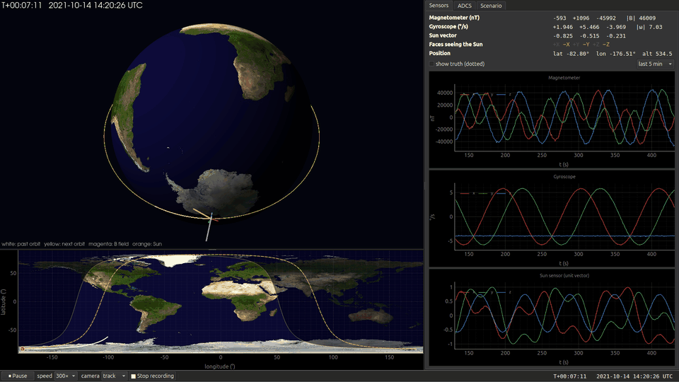

# cubesat-adcs-sim

> **Status: work in progress.** The simulator, the visualization, the reference ADCS in
> Python and the ADCS in C and in Rust run, and the two are compared.



An open-source attitude determination and control system (ADCS) simulator for a 3U CubeSat,
rebuilt from scratch from my MSc thesis
[*Implementation and verification of attitude determination control algorithms for a 3U
CubeSat*](https://aaltodoc.aalto.fi/items/f665d4b5-35c9-4d32-8ee1-40ff1c5f1547)
(Aalto University, 2023).

## What it will contain

- **Simulator (Python):** SGP4 orbit propagation, IGRF magnetic field, Sun position and
  eclipses, rigid-body attitude dynamics, and models of the magnetometer, gyroscope, sun
  sensors and magnetorquers.
- **Visualization:** the satellite over the Earth with its predicted orbit, a ground track,
  and live sensor readings next to what the ADCS corrects in them.
- **ADCS in C:** a Fast Linear Quaternion Attitude Estimator (FLAE) with a two-stage unscented
  Kalman filter, B-dot detumbling and quaternion-feedback control, written like flight
  software: C11, no heap allocation, portable to ARM Cortex-M.
- **ADCS in Rust:** the same algorithms behind the same C interface, and a measured
  comparison of the two implementations.

## Running a scenario

The thesis test cases are in `scenarios/`, set up to run the reference ADCS:

```bash
uv run adcssim run scenarios/case_1a.toml              # writes runs/case_1a_python-ref_<time>.parquet
uv run adcssim run scenarios/case_1a.toml --backend none   # open loop, no ADCS
uv run adcssim run scenarios/case_1a.toml --backend c      # the C library (build it first)
uv run adcssim run scenarios/case_1a.toml --backend rust   # the Rust library (build it first)
uv run python tools/thesis_report.py                   # all cases → docs/results/thesis_cases.md
```

Each run logs truth, sensor readings and ADCS outputs at every control period to a Parquet
file.

## The ADCS

A reference implementation in NumPy (`src/adcssim/adcs_ref/`) with two variants:

- **thesis**: the thesis algorithms (the Fast Linear Quaternion Attitude Estimator, FLAE,
  feeding a two-stage unscented Kalman filter, B-dot detumbling and quaternion-feedback
  pointing). It reproduces the thesis results, including its open problem: the
  magnetometer bias is not estimated.
- **improved**: an error-state UKF (USQUE) designed from a measured diagnosis of the
  thesis variant. It estimates the magnetometer bias the thesis couldn't (worst error in
  that case 53° → 0.6°), stays accurate through eclipses with realistic sensors (8.6° →
  0.43°) and while detumbling (diverged → 0.58°), and its uncertainty matches its real
  error.

A multiplicative EKF on the same model matches the UKF's accuracy at lower cost
([MEKF baseline](docs/adcs.md#mekf-baseline)).

**In C** (`adcs-c/`), the thesis and MEKF variants behind one interface
([adcs.h](adcs-c/include/adcs.h)): C11 with no heap, built for ARM Cortex-M as well as the
PC, and verified against golden vectors recorded from the Python reference (agreement to
~10⁻¹⁴), under sanitizers and a fuzzer. Any scenario, and the viewer, can run on it with
`--backend c` ([details](docs/adcs.md#the-c-library)).

**In Rust** (`adcs-rs/`), the same algorithms behind the same C interface: a `no_std` core
with no `unsafe` code, and a thin FFI crate that is the only place with `unsafe`. It matches
the golden vectors like the C library, is checked with Miri and a fuzzer, and links into the
same bare-metal C example for Cortex-M. Run it with `--backend rust`
([details](docs/adcs.md#the-rust-library)).

**C vs Rust** ([full comparison](docs/results/c_vs_rust.md)), same driver and inputs for both:

| | C | Rust |
|---|---:|---:|
| Time per step, thesis / MEKF (x86-64, best build) | 11.3 / 1.19 µs (gcc LTO) | 13.8 / 1.21 µs |
| Outputs | bit-identical | bit-identical |
| Code size, Cortex-M4F, size-optimised | 19 KB | 36 KB |
| State / stack per step (double) | 36 KB / 2.5 KB | 42 KB / 5.9 KB |

Speed is a draw (Rust matches clang, which shares its LLVM backend; gcc is fastest on the
UKF); Rust costs memory and code size; the outputs are the same to the last bit.

- [How both variants work, and where and why they differ from the thesis](docs/adcs.md)
- [Thesis test cases](docs/results/thesis_cases.md) ·
  [Diagnosis of the thesis variant](docs/results/diagnosis.md) ·
  [Thesis vs improved](docs/results/variants.md)

## Visualization

```bash
uv sync --extra viz
uv run adcssim view scenarios/case_1a.toml                 # live simulation
uv run adcssim view runs/case_1a_none_<time>.parquet       # replay a log, with seeking
```

The viewer shows the satellite over a rotating, Sun-lit Earth with its past and predicted
orbit (and the estimated attitude as a ghost), the ground track with the day/night
terminator, and live sensor readings (optionally against the truth). The ADCS tab shows what
the ADCS corrects: the magnetometer and gyro biases it estimates and removes from the
readings against the true ones, the attitude error against the filter's own 3σ bound, the
dipole commands and the mode. It can record the window to a GIF. The simulation runs in its own
process, so the UI stays at ~20 fps at any playback speed (up to ~270× real time). What the simulator models, how each model was validated, and its assumptions are in
[docs/simulator.md](docs/simulator.md).


## Repository layout

| Path | Content |
|---|---|
| `src/adcssim/` | Python simulator package |
| `scenarios/` | Scenario files (TOML), including the thesis test cases |
| `data/tle/` | Orbit element sets used by the scenarios |
| `adcs-c/` | ADCS library in C (CMake) |
| `adcs-rs/` | ADCS library in Rust (Cargo workspace) |
| `docs/` | Conventions, maths notes and results |
| `tools/` | Development helper scripts |

## Development

Requirements: Python 3.12+ with [uv](https://docs.astral.sh/uv/), CMake 3.20+ and a C11
compiler, and a stable Rust toolchain.

```bash
uv sync                      # create the virtual environment
uv run pre-commit install    # enable the commit hooks
uv run pytest                # Python tests

cmake -S adcs-c -B adcs-c/build && cmake --build adcs-c/build && ctest --test-dir adcs-c/build

cargo test --release --manifest-path adcs-rs/Cargo.toml
```

## License

[MIT](LICENSE). The thesis itself is published separately under CC BY-NC-SA 4.0; this
repository re-implements its methods from the published equations.
