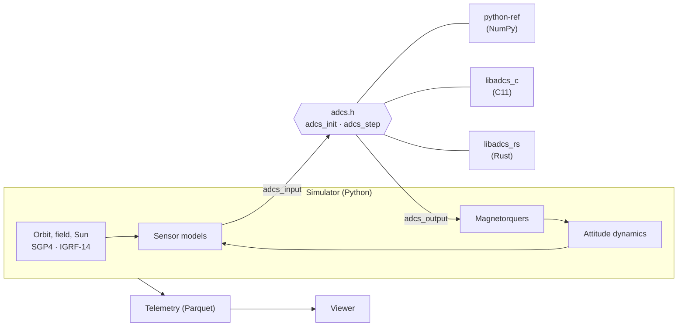
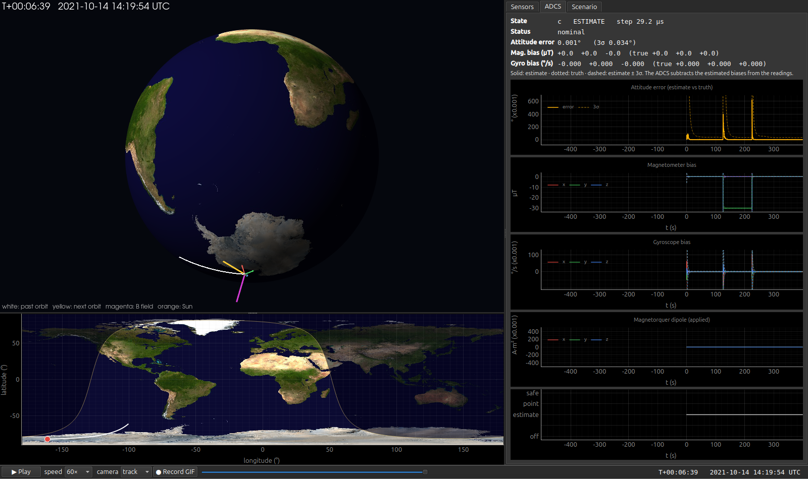

# cubesat-adcs-sim


An attitude determination and control system (ADCS) for a 3U CubeSat, with the simulator to
test it, rebuilt from scratch from my MSc thesis
[*Implementation and verification of attitude determination control algorithms for a 3U
CubeSat*](https://aaltodoc.aalto.fi/items/f665d4b5-35c9-4d32-8ee1-40ff1c5f1547)
(Aalto University, 2023), then improved and implemented twice as flight-style software.

- **Simulator (Python):** SGP4 orbit, IGRF-14 magnetic field, Sun and eclipses, rigid-body
  dynamics with disturbance torques, and models of the magnetometer, gyroscope, sun sensors
  and magnetorquers, each tested against a reference independent of this code.
- **Visualization:** the satellite over a Sun-lit Earth with its predicted orbit, a ground
  track, the sensor readings, and what the ADCS corrects in them.
- **The ADCS, three times:** a NumPy reference that reproduces the thesis and improves on it,
  then the same algorithms in **C** (C11, no heap, Cortex-M ready) and in **Rust** (`no_std`,
  no `unsafe` outside the C interface), behind one C interface that the simulator can load.

## Results

**The thesis, reproduced and diagnosed.** The thesis algorithms (FLAE attitude measurement
feeding a two-stage UKF) reproduce its results, including its open problem: the
magnetometer bias is not estimated. A measured diagnosis
([docs/results/diagnosis.md](docs/results/diagnosis.md)) traced it to the measurement
model, which makes the bias unobservable, compounded by a tuning that freezes it.

**An improved filter.** An error-state UKF (USQUE) and a multiplicative EKF designed from
that diagnosis:

| Worst attitude error | Thesis variant | Improved |
|---|---:|---:|
| Magnetometer bias step (thesis case 2b) | 53° | 0.6° |
| Eclipse with realistic sensors | 8.6° | 0.43° |
| Detumbling | diverged | 0.58° |

Their uncertainty bounds the real error (it stays inside the filters' 3σ), but
conservatively: the reported variance is 2–160× the actual squared error, so the filters
are safe but not calibrated ([docs/results/variants.md](docs/results/variants.md)).

**C vs Rust** ([full comparison](docs/results/c_vs_rust.md)), one benchmark driver and the
same inputs for both:

| | C | Rust |
|---|---:|---:|
| Time per step, thesis / MEKF (x86-64, best build) | 11.3 / 1.19 µs (gcc LTO) | 13.8 / 1.21 µs |
| Outputs | bit-identical | bit-identical |
| Code size, Cortex-M4F, size-optimised | 19 KB | 36 KB |
| State / stack per step (double) | 36 KB / 2.5 KB | 42 KB / 5.9 KB |

Speed is a draw (Rust matches clang, which shares its LLVM backend; gcc is fastest on the
UKF); Rust costs memory and code size; the outputs are the same to the last bit.

## Architecture



The ADCS only sees what a satellite would have: sensor readings, on-board reference vectors
and time. The three implementations are interchangeable behind `adcs.h`, and checked against
the same golden vectors recorded from the reference.

## Running a scenario

The thesis test cases are in `scenarios/`, set up to run the reference ADCS:

```bash
uv run adcssim run scenarios/case_1a.toml              # writes runs/case_1a_python-ref_<time>.parquet
uv run adcssim run scenarios/case_1a.toml --backend none   # open loop, no ADCS
uv run adcssim run scenarios/case_1a.toml --backend c      # the C library (build it first)
uv run adcssim run scenarios/case_1a.toml --backend rust   # the Rust library (build it first)
uv run python tools/thesis_report.py                   # all cases → docs/results/thesis_cases.md
```

Each run logs truth, sensor readings and ADCS outputs at every control period to a Parquet
file.

## The ADCS

| Implementation | Variants | Details |
|---|---|---|
| NumPy reference (`src/adcssim/adcs_ref/`) | thesis, improved (USQUE UKF), MEKF | [docs/adcs.md](docs/adcs.md) |
| C (`adcs-c/`) | thesis, MEKF | [The C library](docs/adcs.md#the-c-library) |
| Rust (`adcs-rs/`) | thesis, MEKF | [The Rust library](docs/adcs.md#the-rust-library) |

How each variant works and where and why it differs from the thesis is in
[docs/adcs.md](docs/adcs.md); the thesis test cases are in
[docs/results/thesis_cases.md](docs/results/thesis_cases.md); the C coding rules are in [docs/c-style.md](docs/c-style.md).

Verification: golden vectors recorded from the reference (the C and Rust libraries match it
to about 10⁻¹⁴), full closed-loop scenarios compared across all three, sanitizers, Miri,
fuzzing (which found a real overflow bug, fixed in all three), static analysis, and
bare-metal builds for Cortex-M4F and M7 in CI.

## Visualization

```bash
uv sync --extra viz
uv run adcssim view scenarios/case_1a.toml                 # live simulation
uv run adcssim view runs/case_1a_none_<time>.parquet       # replay a log, with seeking
```

The viewer shows the satellite over a rotating, Sun-lit Earth with its past and predicted
orbit (and the estimated attitude as a ghost), the ground track with the day/night
terminator, and live sensor readings (optionally against the truth). The ADCS tab shows what
the ADCS corrects: the magnetometer and gyro biases it estimates and removes from the
readings against the true ones, the attitude error against the filter's own 3σ bound, the
dipole commands and the mode. It can record the window to a GIF. The simulation runs in its
own process, so the UI stays at ~20 fps at any playback speed (up to ~270× real time).

What the simulator models, how each model was validated, and its assumptions are in
[docs/simulator.md](docs/simulator.md).



## Repository layout

| Path | Content |
|---|---|
| `src/adcssim/` | Python simulator package |
| `scenarios/` | Scenario files (TOML), including the thesis test cases |
| `data/tle/` | Orbit element sets used by the scenarios |
| `adcs-c/` | ADCS library in C (CMake) |
| `adcs-rs/` | ADCS library in Rust (Cargo workspace) |
| `testdata/golden/` | Golden vectors every implementation must reproduce |
| `docs/` | Conventions, algorithms, results |
| `tools/` | Reports, cross-checks, benchmarks |

## Development

Requirements: Python 3.12+ with [uv](https://docs.astral.sh/uv/), CMake 3.20+ and a C11
compiler, and a stable Rust toolchain.

```bash
uv sync                      # create the virtual environment
uv run pre-commit install    # enable the commit hooks
uv run pytest                # Python tests

cmake -S adcs-c -B adcs-c/build && cmake --build adcs-c/build && ctest --test-dir adcs-c/build

cargo test --release --manifest-path adcs-rs/Cargo.toml
```

## References

- J. Mata Garcia, *Implementation and verification of attitude determination control
  algorithms for a 3U CubeSat*, MSc thesis, Aalto University, 2023.
- J. Wu et al., "Fast Linear Quaternion Attitude Estimator Using Vector Observations",
  *IEEE Transactions on Automation Science and Engineering*, 2018 (FLAE).
- Chen et al., two-stage unscented Kalman filter, as derived in the thesis (§2.4.3).
- J. L. Crassidis and F. L. Markley, "Unscented Filtering for Spacecraft Attitude
  Estimation", *Journal of Guidance, Control, and Dynamics* 26(4), 2003 (USQUE).
- F. L. Markley and J. L. Crassidis, *Fundamentals of Spacecraft Attitude Determination and
  Control*, Springer, 2014 (MEKF, conventions).
- D. A. Vallado et al., "Revisiting Spacetrack Report #3", 2006 (SGP4), and D. A. Vallado,
  *Fundamentals of Astrodynamics and Applications*, 2013.
- IAGA, International Geomagnetic Reference Field, 14th generation (IGRF-14), 2024.

## License

[MIT](LICENSE). The thesis itself is published separately under CC BY-NC-SA 4.0; this
repository re-implements its methods from the published equations.
