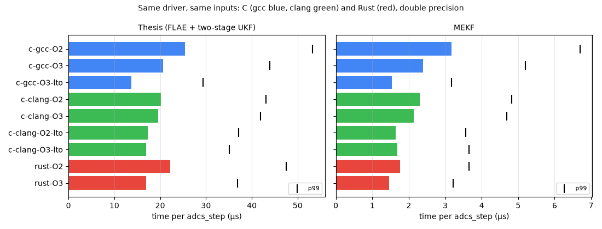

# C vs Rust: the same ADCS in both languages

Both libraries implement `adcs.h` with the same algorithms, the same operation order and the
same hand-written linear algebra (docs/adcs.md), so the differences measured here come from
the languages, compilers and build settings, not from the code's design.

## How it was measured

- **One driver for every library.** `adcs-c/bench/bench.c` is compiled once (gcc -O2, no
  LTO) and linked against each library through `adcs.h`, so the timing code, the inputs and
  the call boundary are identical. Inputs: all 16 golden vectors (8 per variant, 400 steps
  each), replayed 200 times after 20 warm-up passes, in 3 rounds with the configurations
  interleaved. Reported: median over rounds of the mean and percentiles, maximum of the
  maxima.
- **Machine:** Intel Core i7-13700H, run pinned to one performance core (`taskset -c 2`),
  Linux `powersave` governor (changing it needs root), gcc 13.3, clang 18.1, rustc 1.99.1.
  All libraries target the baseline x86-64 CPU (no `-march=native`).
- **Builds:** C with gcc and clang at `-O2` and `-O3`, each with and without link-time
  optimisation (LTO); Rust at `opt-level` 2 and 3, always with `lto = true` and
  `codegen-units = 1` (the workspace's release profile). The Rust library is built
  `no_std`, as for firmware.
- **Code size:** the bare-metal C example linked against each library for a Cortex-M4F
  (single precision) and a Cortex-M7 (double precision), `.text` bytes from
  `arm-none-eabi-size`.

Reproduce: `tools/bench.sh`, `tools/size_report.sh`, then `uv run python tools/plot_bench.py`
(raw data in `docs/results/data/`).

## Speed

Time per `adcs_step` in µs (measured 2026-11-11, after the review fixes of docs/adcs.md;
this run was about 20% slower across every build than the first one on 2026-11-06, a
machine-state difference, so only the ratios between builds carry over):

| Build | Thesis mean | p99 | max | MEKF mean | p99 | max |
|---|---:|---:|---:|---:|---:|---:|
| C gcc -O2 | 25.46 | 53.30 | 305.3 | 3.17 | 6.70 | 63.1 |
| C gcc -O3 | 20.65 | 43.93 | 302.1 | 2.39 | 5.19 | 47.5 |
| C gcc -O3 LTO | **13.73** | **29.36** | 178.9 | 1.53 | 3.17 | 56.4 |
| C clang -O2 | 20.19 | 43.06 | 231.4 | 2.30 | 4.83 | 50.0 |
| C clang -O3 | 19.56 | 41.92 | 243.6 | 2.13 | 4.69 | 52.7 |
| C clang -O2 LTO | 17.26 | 37.14 | 246.2 | 1.64 | 3.57 | 64.1 |
| C clang -O3 LTO | 16.99 | 35.05 | 241.7 | 1.69 | 3.65 | 43.0 |
| Rust opt-level 2 | 22.21 | 47.52 | 262.1 | 1.75 | 3.65 | 90.8 |
| Rust opt-level 3 | 16.93 | 36.85 | 211.4 | **1.46** | 3.22 | 44.8 |

(The "clang -O2 LTO" library is compiled at -O2 but the benchmark links every LTO build
with -O3, so LTO re-optimises it at -O3: it is effectively the same as "clang -O3 LTO".)

- **Build settings matter more than the language.** C compiled file by file is 1.2–2.1×
  slower than the same C with LTO, because the small linear-algebra routines cannot be
  inlined across files. A first run without C LTO showed Rust ahead by up to 2× on the
  MEKF; the gap was LTO, which the Rust release profile enables and a plain C build
  does not.
- **Same backend, same speed.** Rust and clang both compile through LLVM. With LTO on both,
  they tie on the thesis variant (16.9 vs 17.0 µs) and Rust is 14% faster on the MEKF: the
  bounds checks Rust adds cost nothing measurable here.
- **gcc with LTO is fastest** on the thesis variant (19% faster than Rust); on the MEKF
  Rust is 5% faster than gcc.
- **The maxima are the operating system, not the code**: occasional interrupts and context
  switches of 40–300 µs, in every build. p99 is the meaningful tail on a desktop;
  worst-case execution time would need the code on a microcontroller.
- For scale, at 10 Hz the slowest build uses 0.03% of the control period on this machine.

## Accuracy and bit-exactness

All 9 double-precision builds differ from the Python reference by at most 4·10⁻¹² °
(thesis) and 3·10⁻¹⁰ ° (MEKF). On the thesis vectors every build, in both languages, is
**bit-identical** (same FNV-1a hash of every output byte). On the MEKF vectors the 7 C
builds are bit-identical to each other, and the 2 Rust builds to each other; Rust and C
differ in one vector (bad input), from step 181, by one unit in the last place of the
gyro-bias estimate. That comes from sine and cosine (Rust's `libm` crate against glibc),
which give the last bit differently for a few arguments; the other 15 vectors never hit
one. Same operation order and no floating-point contraction (C11 in strict mode, Rust by
default) make everything else independent of the language and the optimiser.

Over full closed-loop scenarios (`tools/crosscheck.py`) Rust and C stay bit-identical in 7 of
10 thesis-variant runs and within 3·10⁻¹² elsewhere, except MEKF detumbling, where the
untuned pointing loop amplifies that last-bit difference to 10⁻³ over three hours
(docs/adcs.md).

### Single precision

Largest attitude difference from the double-precision reference, float builds (identical
for C and Rust):

| Vector | Thesis (°) | MEKF (°) |
|---|---:|---:|
| nominal | 0.0010 | 0.0006 |
| bad input | 0.0012 | 0.0006 |
| gyro bias | 0.0009 | 0.047 |
| magnetometer bias | 0.0019 | 0.0078 |
| eclipse entry | 0.0045 | 0.0002 |
| start in eclipse | 0.0008 | 0.0030 |
| high noise | 0.0011 | 0.0001 |
| control | 0.0014 | 0.0001 |

Both filters work in single precision: the thesis filter within 0.005°, the MEKF within
0.008° except briefly after a declared bias fault (0.05°). The first measurement (up to 42°
for the thesis filter) was a porting bug found in review: the Cholesky jitter was machine
epsilon, which in float (1.2·10⁻⁷) exceeds the process noise on q and ω and acted as extra
noise; it is now 2.2·10⁻¹⁶ in both precisions. This matters on a Cortex-M4F, whose FPU is
single precision only (double is emulated in software). On this x86 CPU float is only
0–21% faster.

## Memory

| Build | State | Stack, `adcs_init` | Stack, step (thesis) | Stack, step (MEKF) |
|---|---:|---:|---:|---:|
| C (gcc -O3 LTO) | 36.0 KB | 1.0 KB | 2.5 KB | 2.3 KB |
| C (clang -O3 LTO) | 36.0 KB | 1.0 KB | 3.1 KB | 2.7 KB |
| Rust opt-level 3 | 41.9 KB | 1.0 KB | 5.1 KB | 3.8 KB |
| C float (clang -O3 LTO) | 18.0 KB | 1.2 KB | 2.0 KB | 0.8 KB |
| Rust float | 21.0 KB | 1.2 KB | 3.0 KB | 2.4 KB |

Stack is measured by running on a pattern-filled thread stack (it includes about 0.3 KB of
the driver's own frame, and under-reports by up to 0.5 KB because the measurement leaves a
red-zone margin). Rust uses more memory:

- **State, +16%:** the C state keeps the two filters in a `union`; the Rust `Adcs` keeps
  both (an `enum` would match C, at the cost of reconstructing it on every `init`).
- **Stack, 1.4–2× per step:** Rust inlines more aggressively, which grows the step's
  frames. `adcs_init` used 8 KB in the first measurement: a non-zero field in the MEKF's
  constant made LLVM copy that 8 KB constant through a stack temporary instead of writing
  it in place. Found in review; the constant is now all zero and `adcs_init` uses the same
  1.0 KB as C.

## Code size on Cortex-M

Size (Berkeley `text`: code plus read-only data) of the bare-metal example (library +
newlib + startup), in bytes:

| Build | Cortex-M4F, float | Cortex-M7, double |
|---|---:|---:|
| C -O2 | 24 616 | 24 380 |
| C -Os | 21 636 | 22 228 |
| C -O2, LTO | 26 708 | 26 964 |
| C -Os, LTO | **20 500** | **21 308** |
| Rust opt-level 2 | 88 772 | 90 068 |
| Rust opt-level s | 34 672 | 33 232 |
| Rust opt-level z | 33 784 | 32 160 |

Rust needs about 1.5–1.7× the size of C when both optimise for size, and 3.6× at
`opt-level` 2, where LLVM fully unrolls the 13×13 loops of the UKF. In the first
measurement's breakdown (size-optimised M4F images) the ADCS functions took 20.5 KB in Rust
and 13.7 KB in C, and Rust added its compiler runtime (2.3 KB, software double arithmetic
used inside `libm`'s float functions) and 5.6 KB of read-only data against 1.0 KB (panic
location records and `libm` tables). Bounds checks are not the main cause: only 24–43 call
sites remain after optimisation.

Both fit easily in the 512 KB–2 MB of flash of typical CubeSat on-board computers; for a
small part (64–128 KB) the difference would matter.

## Safety and verification

| | C | Rust |
|---|---|---|
| Memory-safety tooling | AddressSanitizer + UndefinedBehaviorSanitizer over all tests | Safe by construction outside 4 `unsafe` blocks in the FFI crate; Miri over the unit and FFI tests |
| Static analysis | cppcheck (two false positives when both precisions were analysed together) | clippy pedantic, no findings beyond style |
| Fuzzing | libFuzzer + sanitizers: **found an input-overflow bug** (a finite but absurd gyro rate gave an all-zero quaternion), fixed in the reference and both libraries | libFuzzer: nothing new (ported after the fix) |
| Interface | Layout checked against the ctypes mirror | Layout checked against the C compiler, field by field |
| Foreign-input hazards | Flags were C `bool` (a foreign value of 2 is undefined behaviour); bytes since ABI v4 | Flags read as bytes from the start |

The one bug the tools found was algorithmic and language-independent, found by fuzzing the
first port (C). A later code review (docs/adcs.md, "Review fixes") found more, almost all
shared by all three implementations because they port the same algorithm: none was a
memory-safety bug. The Rust-specific ones were about memory (the 8 KB init stack, a state
too large for the example's buffer, which CI only linked) and an FFI reference formed
before validating the state; the C-specific one was undefined behaviour in a float-to-
integer conversion, which Rust's saturating `as` avoids by definition. The borrow checker prevented nothing here because the code has no dynamic memory or
sharing; its one visible effect was pushing the first Rust draft toward copying a 36 KB
filter onto the stack to satisfy it, which was then replaced by borrowing disjoint fields.

## Effort

| | Lines (no blanks or comments) |
|---|---:|
| C library (`src/`, `adcs.h`) | 1 958 |
| Rust library (`adcs-core`, `adcs-ffi`, no tests) | 2 125 |

The Rust port took less time than the C one, but it came second: the algorithms, the
operation order and the test vectors were already settled, and the C version was the
template. Its main costs were the `no_std` maths (a crate instead of the system library),
the FFI boundary, and test tolerances that work in both precisions.

## Conclusions

1. **Speed is a draw; build settings decide it.** With LTO on both sides, Rust matches
   clang (same LLVM backend) and gcc is fastest on the larger filter. Without LTO, C loses
   to Rust's default release profile.
2. **Results are bit-identical** across compilers and optimisation levels, and across the
   languages except where their sine and cosine differ in the last bit.
3. **Rust costs memory:** about 1.5–1.7× the code size when optimised for size, up to 2×
   the stack per step and 16% more state, all small in absolute terms for a CubeSat
   computer.
4. **Single precision works in both languages, for both filters.** An apparent failure of
   the thesis filter in float was a shared porting bug, found in review.
5. **Not measured:** timing on a real Cortex-M (no board), per-stage timing, and a third
   implementation using `nalgebra`.
