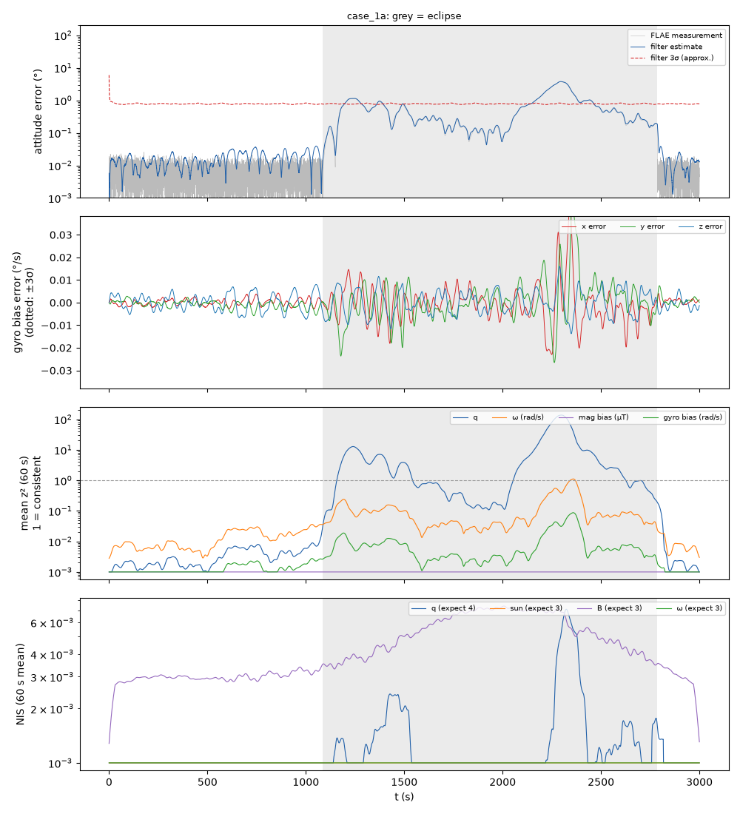
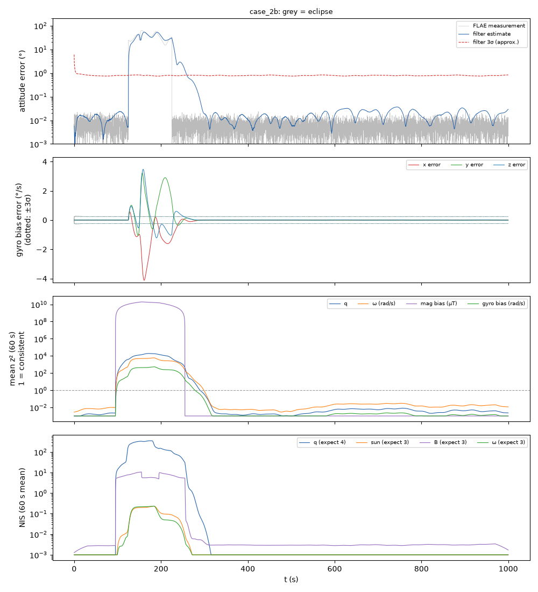
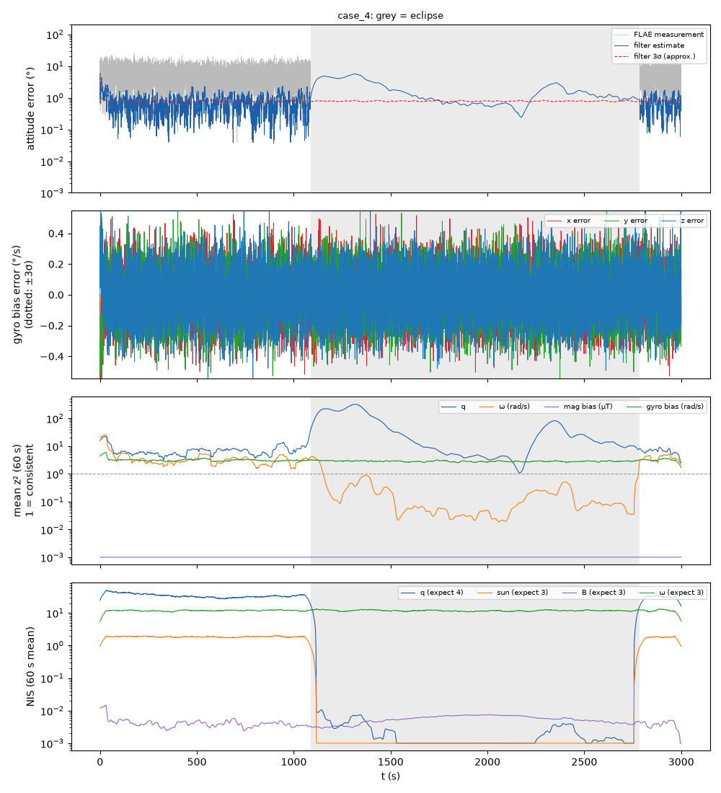
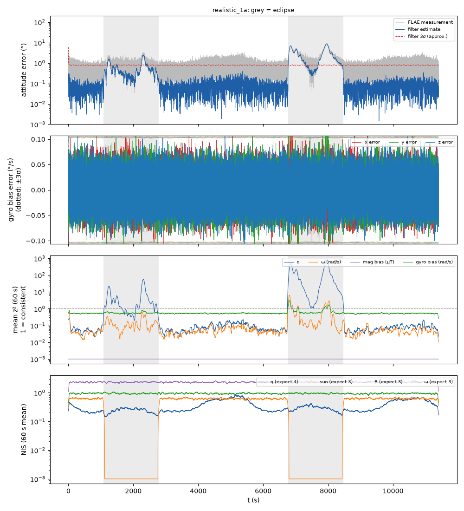
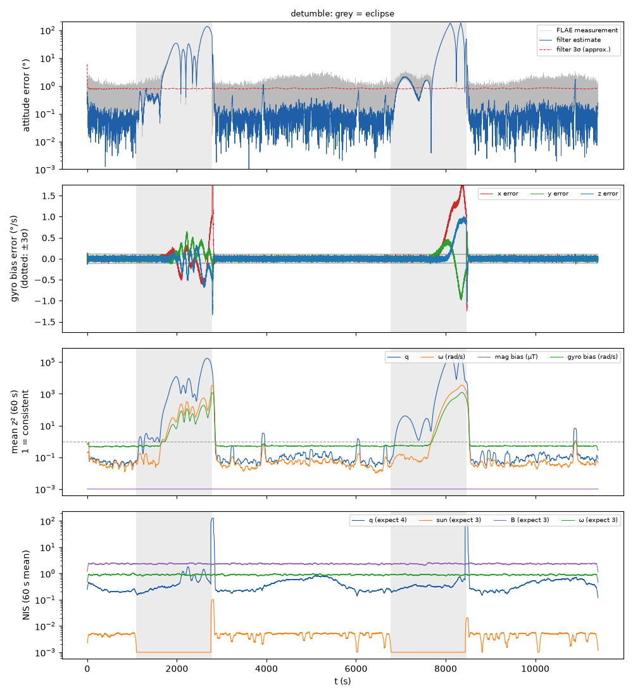

# Filter diagnostics (generated)

Generated by `tools/diagnose.py`; the interpretation is in [diagnosis.md](diagnosis.md).
The first 60 s after the first estimate are excluded.

## Consistency: estimation error against the filter's own σ

Within 3σ: share of samples with |error| < 3σ (a consistent filter: ~0.997). Mean z²: mean of (error/σ)² (consistent: ~1; ≫ 1 means overconfident).

| Scenario | Block | Sunlit: within 3σ / mean z² | Eclipse: within 3σ / mean z² |
|---|---|---|---|
| case_1a | q | 1.000 / 0.00 | 0.833 / 11.25 |
| case_1a | ω (rad/s) | 1.000 / 0.01 | 1.000 / 0.13 |
| case_1a | gyro bias (rad/s) | 1.000 / 0.00 | 1.000 / 0.01 |
| case_1a | mag bias (µT) | 1.000 / 0.00 | 1.000 / 0.00 |
| case_2b | q | 0.868 / 1493.66 | – |
| case_2b | ω (rad/s) | 0.856 / 489.47 | – |
| case_2b | gyro bias (rad/s) | 0.885 / 43.21 | – |
| case_2b | mag bias (µT) | 0.965 / 1.88e+09 | – |
| case_4 | q | 0.795 / 6.50 | 0.488 / 55.35 |
| case_4 | ω (rad/s) | 0.904 / 3.29 | 0.996 / 0.27 |
| case_4 | gyro bias (rad/s) | 0.911 / 3.12 | 0.925 / 2.85 |
| case_4 | mag bias (µT) | 1.000 / 0.00 | 1.000 / 0.00 |
| realistic_1a | q | 1.000 / 0.07 | 0.667 / 59.37 |
| realistic_1a | ω (rad/s) | 1.000 / 0.05 | 0.993 / 0.44 |
| realistic_1a | gyro bias (rad/s) | 1.000 / 0.52 | 0.998 / 0.68 |
| realistic_1a | mag bias (µT) | 1.000 / 0.00 | 1.000 / 0.00 |
| detumble | q | 0.988 / 20.26 | 0.388 / 2.67e+04 |
| detumble | ω (rad/s) | 0.991 / 26.26 | 0.604 / 307.93 |
| detumble | gyro bias (rad/s) | 0.992 / 9.68 | 0.651 / 107.95 |
| detumble | mag bias (µT) | 1.000 / 0.00 | 1.000 / 0.00 |

## Innovations: NIS per measurement group (median / mean; expected mean in brackets)

| Scenario | Group | Sunlit | Eclipse |
|---|---|---|---|
| case_1a | q (4) | 0.00 / 0.00 | 0.00 / 0.00 |
| case_1a | sun (3) | 0.00 / 0.00 | – |
| case_1a | B (3) | 0.00 / 0.00 | 0.01 / 0.01 |
| case_1a | ω (3) | 0.00 / 0.00 | 0.00 / 0.00 |
| case_2b | q (4) | 0.00 / 29.07 | – |
| case_2b | sun (3) | 0.00 / 0.02 | – |
| case_2b | B (3) | 0.00 / 1.22 | – |
| case_2b | ω (3) | 0.00 / 0.02 | – |
| case_4 | q (4) | 20.12 / 33.51 | 0.00 / 0.00 |
| case_4 | sun (3) | 1.29 / 1.85 | – |
| case_4 | B (3) | 0.00 / 0.00 | 0.01 / 0.01 |
| case_4 | ω (3) | 9.45 / 11.84 | 9.35 / 11.81 |
| realistic_1a | q (4) | 0.23 / 0.38 | 0.15 / 0.26 |
| realistic_1a | sun (3) | 0.43 / 0.62 | – |
| realistic_1a | B (3) | 1.83 / 2.32 | 1.82 / 2.31 |
| realistic_1a | ω (3) | 0.74 / 0.93 | 0.74 / 0.94 |
| detumble | q (4) | 0.22 / 1.90 | 0.26 / 0.43 |
| detumble | sun (3) | 0.00 / 0.01 | – |
| detumble | B (3) | 1.83 / 2.31 | 1.84 / 2.33 |
| detumble | ω (3) | 0.70 / 0.89 | 0.69 / 0.89 |

## FLAE measurement vs filter estimate (attitude error, °: median / p95)

| Scenario | Sunlit: FLAE | Sunlit: filter | Eclipse: FLAE | Eclipse: filter |
|---|---|---|---|---|
| case_1a | 0.005 / 0.012 | 0.014 / 0.033 | 0.386 / 2.687 | 0.394 / 2.702 |
| case_2b | 0.006 / 35.800 | 0.018 / 33.933 | – | – |
| case_4 | 5.144 / 12.241 | 0.615 / 1.430 | 1.176 / 4.725 | 1.172 / 4.793 |
| realistic_1a | 0.552 / 1.274 | 0.066 / 0.148 | 0.962 / 5.951 | 0.688 / 5.973 |
| detumble | 0.542 / 1.291 | 0.073 / 0.214 | 3.910 / 131.990 | 3.910 / 132.410 |

## Figures

### case_1a

### case_2b

### case_4

### realistic_1a

### detumble

