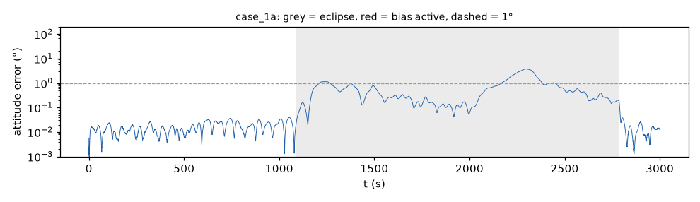
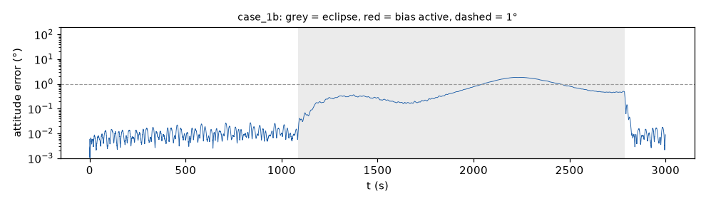
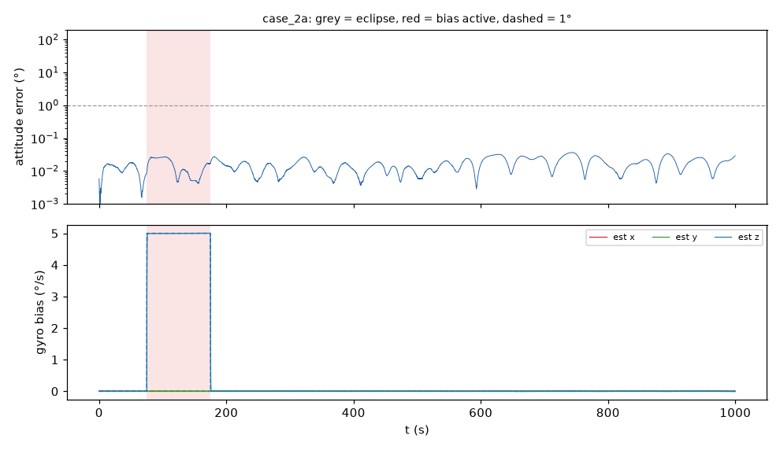
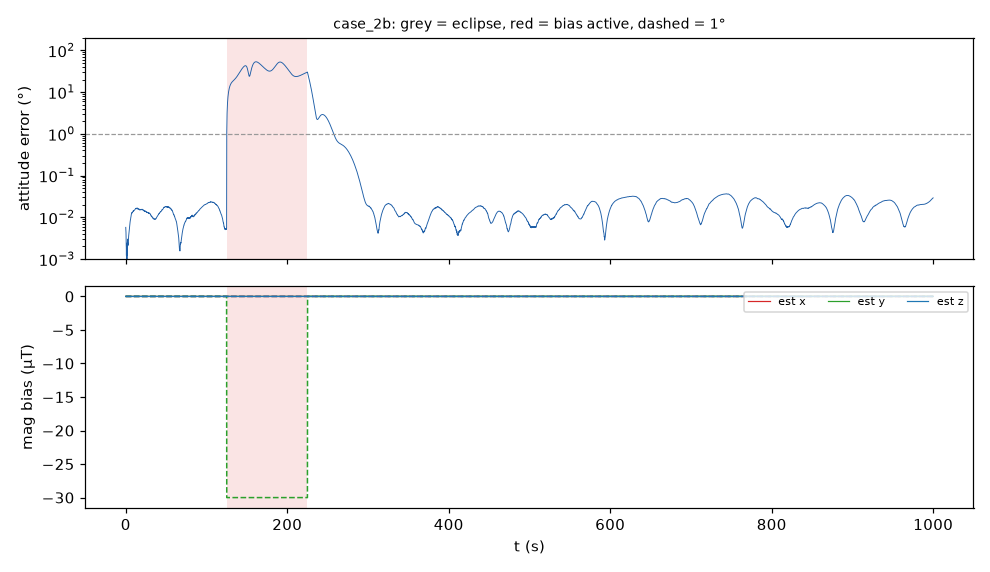
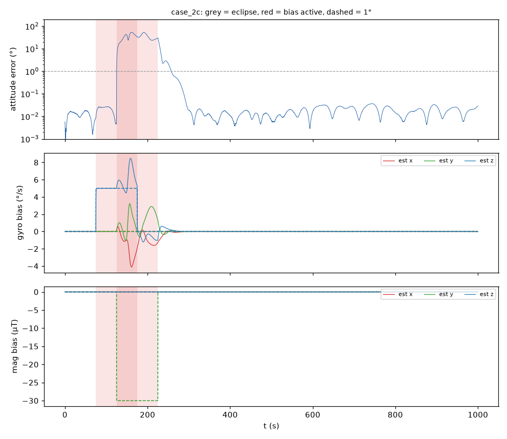
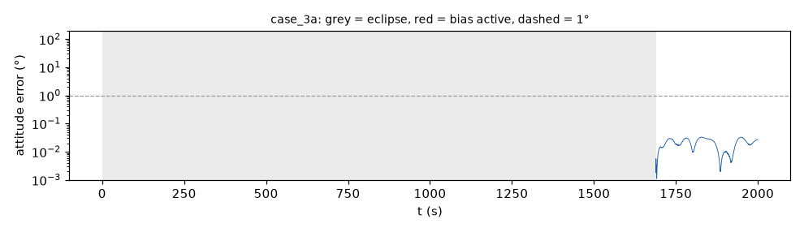
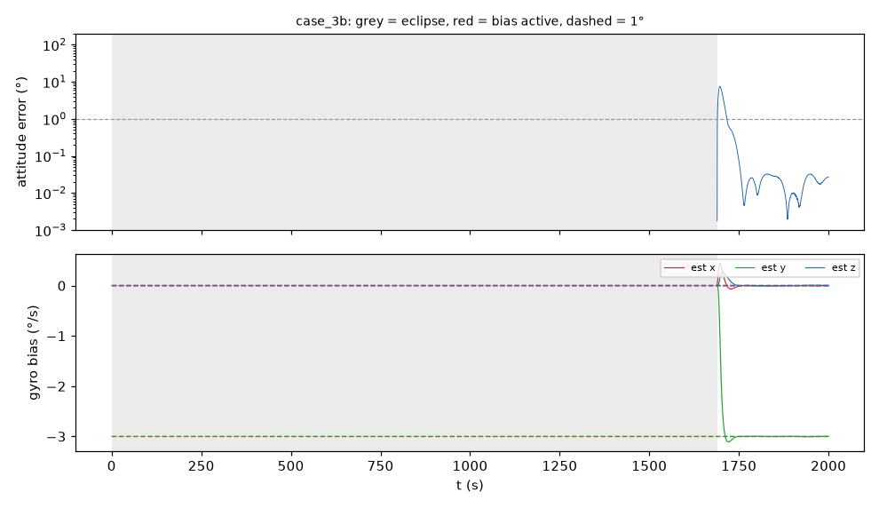
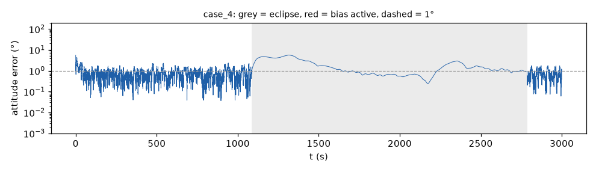

# Thesis test cases: results

Backend `python-ref`. Generated by `tools/thesis_report.py`; every number comes from running the scenario files in `scenarios/` unchanged. How the implementation differs from the thesis, and why, is in [../adcs.md](../adcs.md).

Attitude error is the angle between estimated and true attitude. *Converged* means below 1° for 30 s; statistics are taken after that point and exclude bias windows (plus 30 s).

| Case | First estimate (s) | Converged after (s) | Sunlit median / p95 / max (°) | Eclipse median / p95 / max (°) | Max during bias (°) | Thesis (§5.6) |
|---|---|---|---|---|---|---|
| case_1a | 0.0 | 0.0 | 0.01 / 0.03 / 0.18 | 0.39 / 2.70 / 3.77 | – | converges within 10 s (gyro ~40 s); < 1° in eclipse; reconverges < 20 s |
| case_1b | 0.0 | 0.0 | 0.01 / 0.02 / 0.48 | 0.46 / 1.77 / 1.83 | – | similar convergence; slightly larger eclipse error; reconverges < 40 s |
| case_2a | 0.0 | 0.0 | 0.01 / 0.03 / 0.04 | – / – / – | 0.0 | gyro bias correctly identified, no impact on the state |
| case_2b | 0.0 | 0.0 | 0.02 / 0.04 / 1.33 | – / – / – | 53.2 | magnetometer bias not estimated; estimate diverges during the fault |
| case_2c | 0.0 | 0.0 | 0.02 / 0.04 / 1.33 | – / – / – | 53.2 | (described in §5.5 but not run in the thesis) |
| case_3a | 1689.3 | 0.0 | 0.02 / 0.03 / 0.03 | – / – / – | – | inconclusive in eclipse; ~50 s to converge once valid |
| case_3b | 1689.3 | 27.0 | 0.02 / 0.46 / 0.99 | – / – / – | – | gyro bias identified |
| case_4 | 0.0 | 318.1 | 0.61 / 1.47 / 2.34 | 1.17 / 4.79 / 5.63 | – | error below 1° at all times, within 0.5° once converged |

## Bias estimates

| Case | Bias | True | Estimated |
|---|---|---|---|
| case_2a | gyroscope (°/s) | [0, 0, 5] | [-0.000242, -0.000384, 5] |
| case_2b | magnetometer (nT) | [0, -3e+04, 0] | [-0.000244, -0.00177, 0.000464] |
| case_2c | gyroscope (°/s) | [0, 0, 5] | [-1.67, 0.862, 6.12] |
| case_2c | magnetometer (nT) | [0, -3e+04, 0] | [-0.000243, -0.00177, 0.000464] |
| case_3b | gyroscope (°/s) | [0, -3, 0] | [-0.00317, -3, 0.00451] |

## Figures

### case_1a

### case_1b

### case_2a

### case_2b

### case_2c

### case_3a

### case_3b

### case_4

