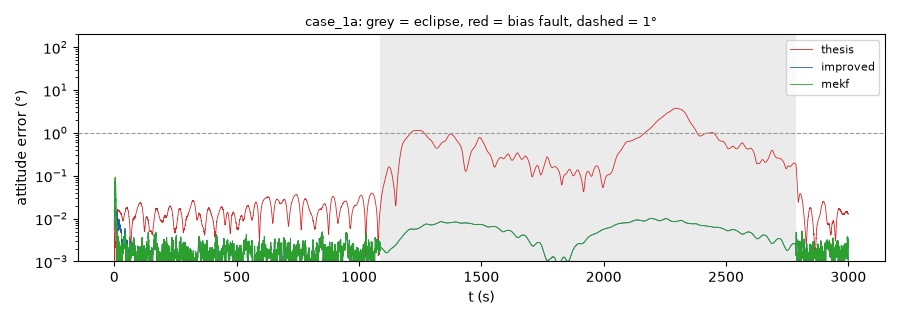
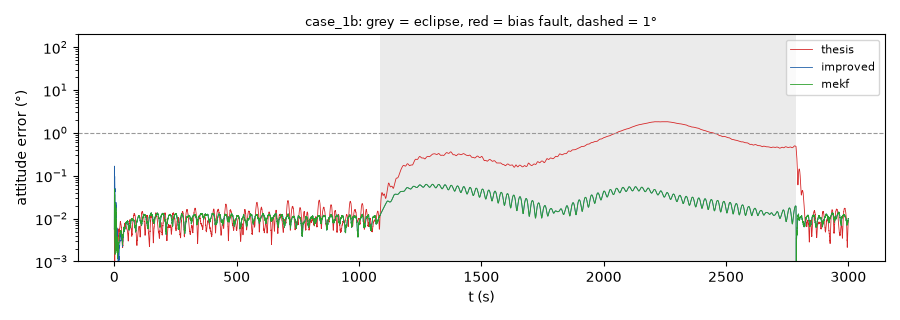
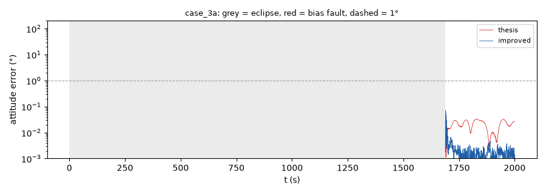
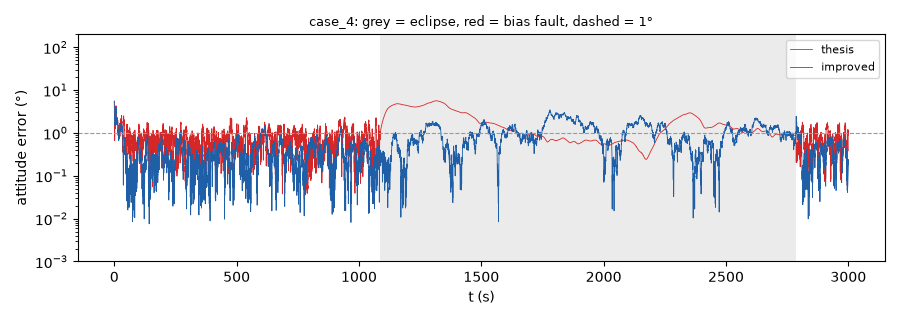

# ADCS variants compared: thesis, improved (UKF), MEKF (generated)

Generated by `tools/compare_variants.py`. Same scenarios and noise realisations for all variants; the improved and MEKF variants' noise settings are matched to each scenario's sensors. Errors are attitude errors in degrees (median / p95 / max), excluding the first 60 s and, except in the fault column, the bias-fault windows plus 30 s. *Within 3σ*: share of samples where the error is inside the filter's own 3σ bound (a consistent filter: ~0.997; this share alone cannot reveal an over-cautious filter, see the README). What the variants are: [../adcs.md](../adcs.md).

| Scenario | Variant | Sunlit | Eclipse | Max in fault | Within 3σ | Gyro-bias RMS error (°/s) | ms/step |
|---|---|---|---|---|---|---|---|
| case_1a | thesis | 0.01 / 0.03 / 0.18 | 0.39 / 2.70 / 3.77 | – | 0.849 | 0.0064 | 1.96 |
| case_1a | improved | 0.00 / 0.00 / 0.01 | 0.01 / 0.01 / 0.01 | – | 1.000 | 0.0001 | 0.97 |
| case_1a | mekf | 0.00 / 0.00 / 0.01 | 0.01 / 0.01 / 0.01 | – | 1.000 | 0.0001 | 0.78 |
| case_1b | thesis | 0.01 / 0.02 / 0.48 | 0.46 / 1.77 / 1.83 | – | 0.829 | 0.0033 | 1.85 |
| case_1b | improved | 0.01 / 0.01 / 0.01 | 0.03 / 0.06 / 0.06 | – | 1.000 | 0.0012 | 0.97 |
| case_1b | mekf | 0.01 / 0.01 / 0.01 | 0.03 / 0.06 / 0.06 | – | 1.000 | 0.0012 | 0.72 |
| case_2a | thesis | 0.01 / 0.03 / 0.04 | – / – / – | 0.03 | 1.000 | 0.0026 | 1.63 |
| case_2a | improved | 0.00 / 0.00 / 0.00 | – / – / – | 1.73 | 1.000 | 0.0001 | 0.91 |
| case_2a | mekf | 0.00 / 0.00 / 0.02 | – / – / – | 1.34 | 1.000 | 0.0001 | 0.66 |
| case_2b | thesis | 0.02 / 0.04 / 1.33 | – / – / – | 53.18 | 0.857 | 0.0162 | 1.68 |
| case_2b | improved | 0.00 / 0.00 / 0.00 | – / – / – | 0.62 | 1.000 | 0.0001 | 0.89 |
| case_2b | mekf | 0.00 / 0.00 / 0.00 | – / – / – | 0.62 | 1.000 | 0.0001 | 0.68 |
| case_2c | thesis | 0.02 / 0.04 / 1.33 | – / – / – | 53.18 | 0.857 | 0.0168 | 1.57 |
| case_2c | improved | 0.00 / 0.00 / 0.00 | – / – / – | 1.73 | 0.999 | 0.0001 | 0.86 |
| case_2c | mekf | 0.00 / 0.00 / 0.00 | – / – / – | 1.33 | 0.999 | 0.0001 | 0.62 |
| case_3a | thesis | 0.02 / 0.03 / 0.03 | – / – / – | – | 1.000 | 0.0031 | 0.36 |
| case_3a | improved | 0.00 / 0.00 / 0.00 | – / – / – | – | 1.000 | 0.0001 | 0.20 |
| case_3a | mekf | 0.00 / 0.00 / 0.00 | – / – / – | – | 1.000 | 0.0001 | 0.18 |
| case_3b | thesis | 0.02 / 0.03 / 0.08 | – / – / – | – | 1.000 | 0.0029 | 0.40 |
| case_3b | improved | 0.00 / 0.00 / 0.00 | – / – / – | – | 1.000 | 0.0001 | 0.24 |
| case_3b | mekf | 0.00 / 0.00 / 0.00 | – / – / – | – | 1.000 | 0.0001 | 0.17 |
| case_4 | thesis | 0.62 / 1.43 / 2.34 | 1.17 / 4.79 / 5.63 | – | 0.434 | 0.1377 | 1.74 |
| case_4 | improved | 0.28 / 0.82 / 2.44 | 0.92 / 2.34 / 3.46 | – | 0.998 | 0.0053 | 0.97 |
| case_4 | mekf | 0.28 / 0.82 / 2.44 | 0.92 / 2.34 / 3.47 | – | 0.998 | 0.0053 | 0.68 |
| realistic_1a | thesis | 0.07 / 0.15 / 0.55 | 0.69 / 5.97 / 8.64 | – | 0.862 | 0.0267 | 1.83 |
| realistic_1a | improved | 0.05 / 0.10 / 0.22 | 0.11 / 0.27 / 0.43 | – | 1.000 | 0.0011 | 1.00 |
| realistic_1a | mekf | 0.05 / 0.10 / 0.22 | 0.11 / 0.27 / 0.43 | – | 1.000 | 0.0011 | 1.13 |
| detumble | thesis | 0.11 / 1.64 / 179.91 | 41.16 / 167.83 / 179.99 | – | 0.688 | 0.4948 | 1.96 |
| detumble | improved | 0.05 / 0.11 / 0.30 | 0.16 / 0.52 / 0.87 | – | 1.000 | 0.0009 | 1.01 |
| detumble | mekf | 0.05 / 0.11 / 0.30 | 0.16 / 0.52 / 0.87 | – | 1.000 | 0.0009 | 0.93 |

## Figures

### case_1a

### case_1b

### case_2a

### case_2b

### case_2c

### case_3a

### case_3b

### case_4

### realistic_1a

### detumble

